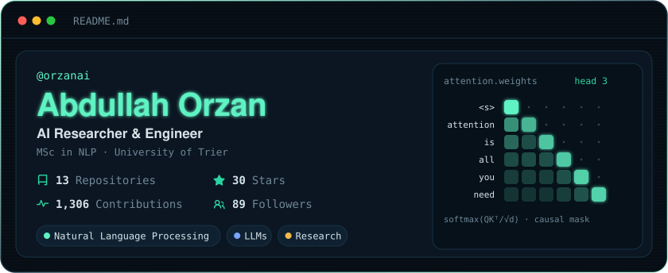
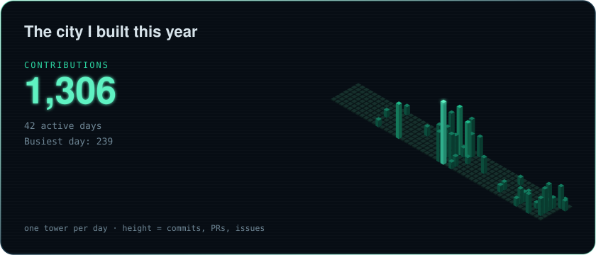
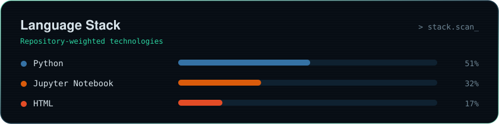

### About me

AI Researcher & Engineer, currently doing my **MSc in Natural Language Processing** at the University of Trier.
I work on **large language models** and NLP, from research questions to working systems.

**Research interests**
- Natural Language Processing
- Large Language Models
- Research on how language models are built, evaluated and applied

**Connect:** [LinkedIn](https://www.linkedin.com/in/abdullah-orzan)

The cards above rebuild daily from my GitHub activity with a small GitHub Action.
